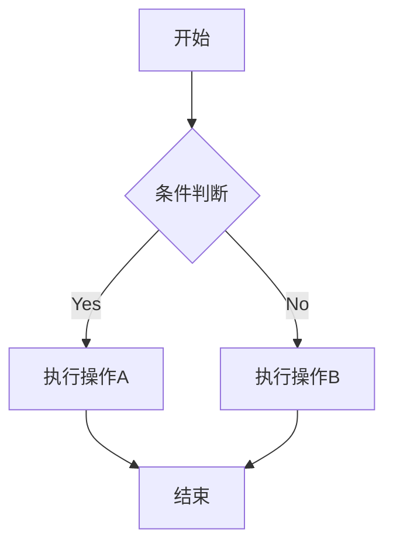

# mall
  
## 项目框架  
- 项目主体框架：SpringBoot + Spring Cloud + Spring Cloud Alibaba
- 数据库：Mysql
- 注册中心：Nacos
- 配置中心：Nacos
- 网关：Spring Cloud Gateway
  * 安全框架： Spring Security
  * 第二项
  * 第三项
- 接口文档：Knife4j 
  * 文档地址：http://ip:port/doc.html
  * swagger地址：http://ip:port/swagger-ui/index.html

JDK版本：17

## 项目模块
- 后台模块   admin
- 公共模块   common
- 优惠卷模块  coupon
- 网关模块   gateway
- 代码生成模块 generator
- 用户模块   member
- 订单模块   order
- 产品模块   product
- 库存模块   ware


## 整体框架
```
客户端 → Spring Cloud Gateway（安全拦截） → 微服务（业务逻辑）
        │  
        ├─ 认证（JWT/OAuth2）  
        ├─ 授权（角色/权限校验）  
        └─ 路由过滤
```




## 功能
- 网关-API动态路由功能

## Git 贡献提交规范

参考 [vue](https://github.com/vuejs/vue/blob/dev/.github/COMMIT_CONVENTION.md) 规范 ([Angular](https://github.com/conventional-changelog/conventional-changelog/tree/master/packages/conventional-changelog-angular))

- `feat` 增加新功能
- `fix` 修复问题/BUG
- `style` 代码风格相关无影响运行结果的
- `perf` 优化/性能提升
- `refactor` 重构
- `revert` 撤销修改
- `test` 测试相关
- `docs` 文档/注释
- `chore` 依赖更新/脚手架配置修改等
- `ci` 持续集成
- `types` 类型定义文件更改